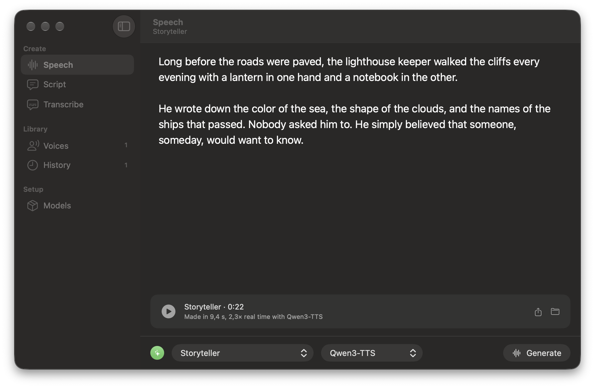

<p align="center">
  
</p>

# Hypervoice

A native macOS app for cloning, designing and generating voices on your Mac.



## Models

- Cloning, voice design and built-in voices through MLX: Qwen3-TTS, Chatterbox Turbo, OmniVoice, Kokoro, Pocket TTS and Phonon.
- LFM3 Audio (Liquid AI): a female and a male voice in 18 languages, run by llama.cpp, which Hypervoice downloads and manages. [LFM Open License v1.0](https://huggingface.co/LiquidAI/LFM3-Audio-2B-GGUF/blob/main/LICENSE).
- Whisper for transcription, or LFM3 Audio through the API (`-F model=lfm3`).

## Installation

```sh
curl -fsSL https://raw.githubusercontent.com/alexisbcz/hypervoice/main/install.sh | bash
```

[MIT License](LICENSE)
